<p align="center">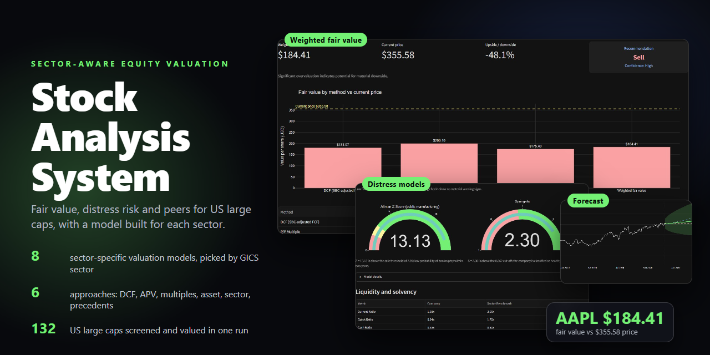</p>

<h1 align="center">Stock Analysis System</h1>
<p align="center"><b>Sector-aware fundamental analysis and valuation of US large-cap stocks, in a local Streamlit app.</b><br>
A dedicated valuation model per GICS sector blends DCF, APV, multiples and asset methods into one fair value, next to distress scores, risk-adjusted ratios, peers, a screener and price forecasts.</p>

<p align="center">
  <a href="#screenshots"><b>Screenshots</b></a> &nbsp;·&nbsp;
  <a href="#quickstart">Quickstart</a> &nbsp;·&nbsp;
  <a href="docs/USER_GUIDE.md">User guide</a> &nbsp;·&nbsp;
  <a href="docs/METHODOLOGY.md">Methodology</a> &nbsp;·&nbsp;
  <a href="CHANGELOG.md">Changelog</a>
</p>

<p align="center">
  <a href="https://github.com/imnotkeril/Stock_Valuation/actions/workflows/ci.yml"></a>
  
  
  <a href="LICENSE"></a>
</p>

<p align="center">
  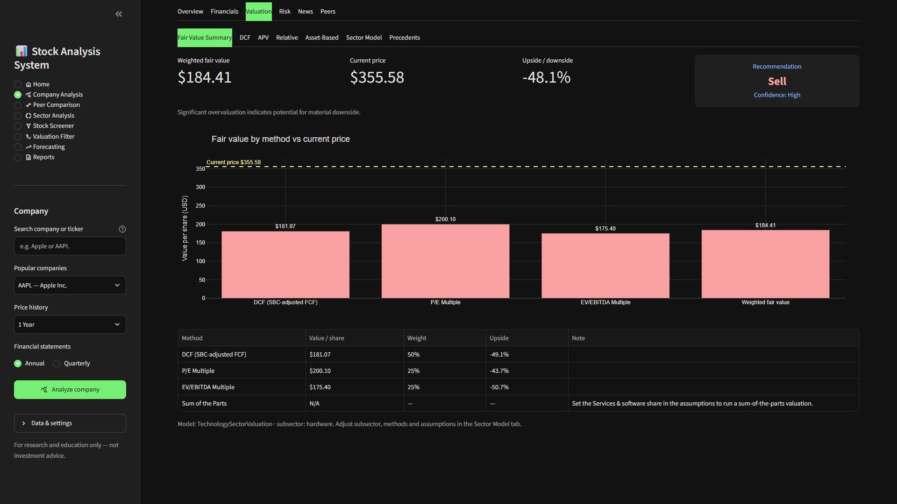
</p>

> **For research and education only. This is not investment advice.** Every value the app shows is a model estimate built from public data (Yahoo Finance, FRED, SEC EDGAR). No output is a recommendation to buy or sell a security, and the app never trades. There is no hosted demo: it runs locally in a minute (see [Quickstart](#quickstart)).

## Highlights
- **One fair value per company, built for its sector.** 8 sector models (banks get residual income and justified P/B, REITs get NAV and P/FFO, tech gets SBC-adjusted DCF) blended by documented weights, with a recommendation and a High / Medium / Low confidence.
- **One cost of capital everywhere.** Risk-free rate from FRED `DGS10`, ERP 4.4 %, Blume beta, clamped WACC (ADR-007); the DCF tab fades growth to terminal and deducts stock-based compensation.
- **Distress and risk in one tab.** Altman Z (variant by sector), Springate, Zmijewski probit, liquidity vs sector, stress tests, VaR / CVaR, Sharpe, Sortino, Treynor, Calmar, information ratio and Jensen's alpha vs the S&P 500.
- **Universe-wide tools.** Screener and valuation filter over 132 US large caps (the full universe is valued in about 33 s with parallel fetching), peer and sector comparison, ensemble price forecasts.
- **Every number explained.** [docs/METHODOLOGY.md](docs/METHODOLOGY.md) lists each formula, default, bound and known bias; golden hand-computed tests pin the models.

## Architecture
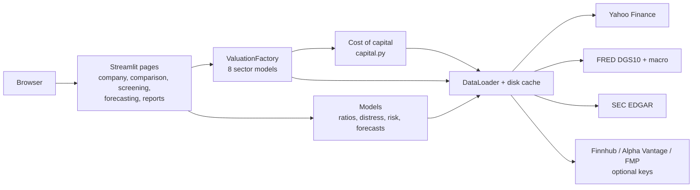
Pages call the valuation factory and the analysis models; all market data goes through one `DataLoader` with a disk cache (`StockAnalysisSystem/src/data/cache`, git-ignored) that serves the last copy when a provider is down. No database, no accounts, no background jobs. Design decisions live in [`docs/adr/`](docs/adr/) and [`docs/ARCHITECTURE.md`](docs/ARCHITECTURE.md).

## What it does
| Area | What you get |
|---|---|
| **Company analysis** | Price chart with moving averages and volume, key statistics, business profile, performance vs. the sector ETF, technical indicators |
| **Overview** | SEC EDGAR filings and 10-year XBRL history (needs `SEC_EDGAR_USER_AGENT`); insider transactions with a 90-day open-market buy/sell summary (needs `FINNHUB_API_KEY`) |
| **Financials** | Income statement, balance sheet, cash flow, margins, growth/CAGR, common-size statements, financial health score, ratios with sector benchmarks, A1-A4 / P1-P4 liquidity grouping |
| **Valuation** | Weighted fair value with a recommendation and confidence level; DCF tab on unlevered FCF with growth fade and SBC; APV; relative multiples on live sector medians; asset-based value and liquidation value; sector model; precedent transactions (cross-check) |
| **Sector models** | A dedicated model for every GICS sector, with subsector methods and adjustable assumptions (see below) |
| **Risk** | Altman Z (variant chosen by sector), Springate, Zmijewski (probit), liquidity and solvency, scenario and revenue stress tests, volatility, VaR / CVaR, max drawdown, Sharpe, Sortino, Treynor, Calmar, information ratio and Jensen's alpha vs. the S&P 500 |
| **News** | Headlines with sentiment, daily sentiment chart, peers (Finnhub; Alpha Vantage with a premium key) |
| **Comparison** | Peer comparison (performance, ratios, valuation), sector analysis vs. the market, side-by-side comparison of several sectors |
| **Screening** | Ratio-based stock screener with presets and saved templates, and a valuation filter for under- and over-valued stocks |
| **Forecasting** | ARIMA, exponential smoothing, linear, machine learning, neural network (MLP) and ensemble price forecasts with confidence bands and backtests; fundamentals forecasts; FRED macro indicators |
| **Reports** | Company, valuation, comparison and sector reports as Excel, CSV, JSON, **HTML** or PDF downloads (Excel and PDF need `openpyxl` and `fpdf2`, both in `requirements.txt`) |

### Sector-specific valuation

`ValuationFactory` maps each company to a specialised model. Every model declares its subsectors, methods and user-adjustable assumptions, and the UI builds its controls from that declaration.

| Sector (GICS) | Model | Examples of methods |
|---|---|---|
| Technology | `TechnologySectorValuation` | SBC-adjusted DCF, revenue DCF, EV/Revenue & EV/EBITDA multiples, Rule-of-40 adjusted multiples |
| Financials | `FinancialSectorValuation` | Residual income / excess return, justified P/B, P/E, dividend discount (common equity; no DCF) |
| Energy, Utilities | `EnergySectorValuation` | DCF, reserve-based NAV, sum-of-the-parts, regulated asset base, contracted cash flows |
| Consumer Discretionary, Consumer Staples | `RetailSectorValuation` | Retail DCF, multiples, store-based / unit economics, sum-of-the-parts |
| Industrials, Materials | `ManufacturingSectorValuation` | Cycle-normalised DCF, replacement value, multiples, earnings power value |
| Real Estate | `RealEstateValuation` | NAV (cap rate on NOI), P/FFO and P/AFFO (Nareit FFO), real estate DCF |
| Healthcare | `HealthcareValuation` | R&D-capitalised DCF, healthcare multiples, pipeline rNPV |
| Communication Services | `CommunicationValuation` | DCF, multiples, subscriber/user-based valuation on cash margin, content library value |

All models return the same result schema (`BaseValuation.build_valuation_result`): per-method values, a weighted fair value, upside versus the current price, a recommendation and a confidence level. Method weights and subsector overrides are listed in [docs/METHODOLOGY.md §6](docs/METHODOLOGY.md#6-sector-models-and-blending-weights).

## Screenshots
All shots are 1920x1080 from a local run on live data (prices through 2026-11-25).

| | |
|---|---|
|  | 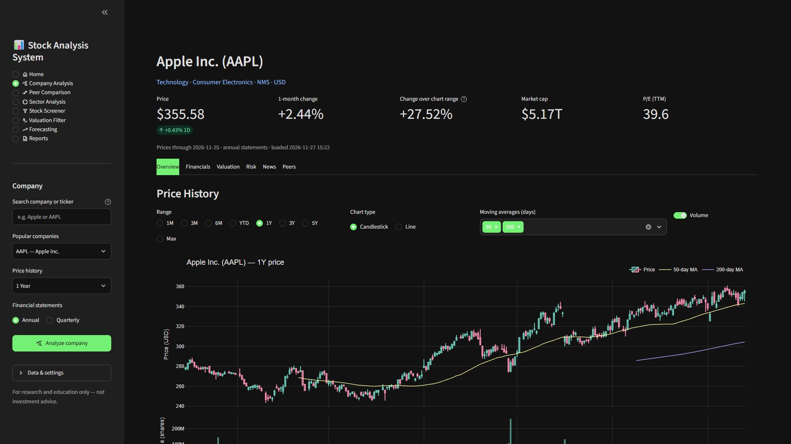 |
| **Home.** Entry to every tool, quick-start tickers and a sector snapshot. | **Company overview (AAPL).** Price, key statistics and a 1Y candlestick chart with 50/200-day averages. |
|  | 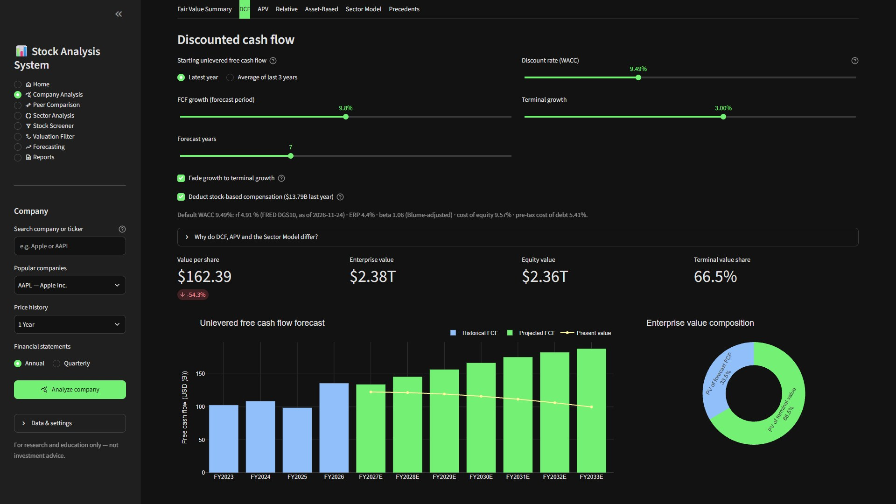 |
| **Fair value summary (AAPL).** Technology model: SBC-adjusted DCF and multiples weighted into $184.41, Sell, High confidence. | **Interactive DCF (AAPL).** Unlevered FCF, growth fade, SBC deducted, WACC from FRED; a separate cross-check of the sector DCF. |
| 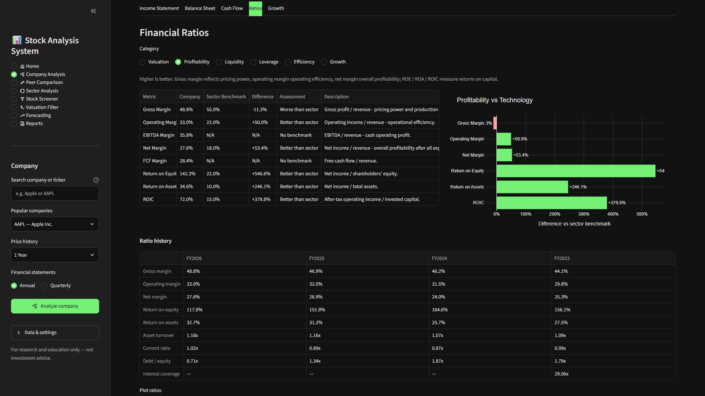 | 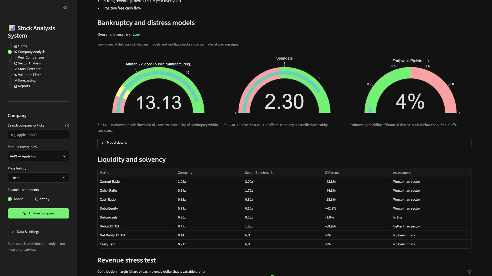 |
| **Ratios vs sector (AAPL).** Profitability against the Technology benchmark, with four years of ratio history. | **Distress models (AAPL).** Altman Z, Springate and Zmijewski gauges plus liquidity and solvency vs the sector. |
| 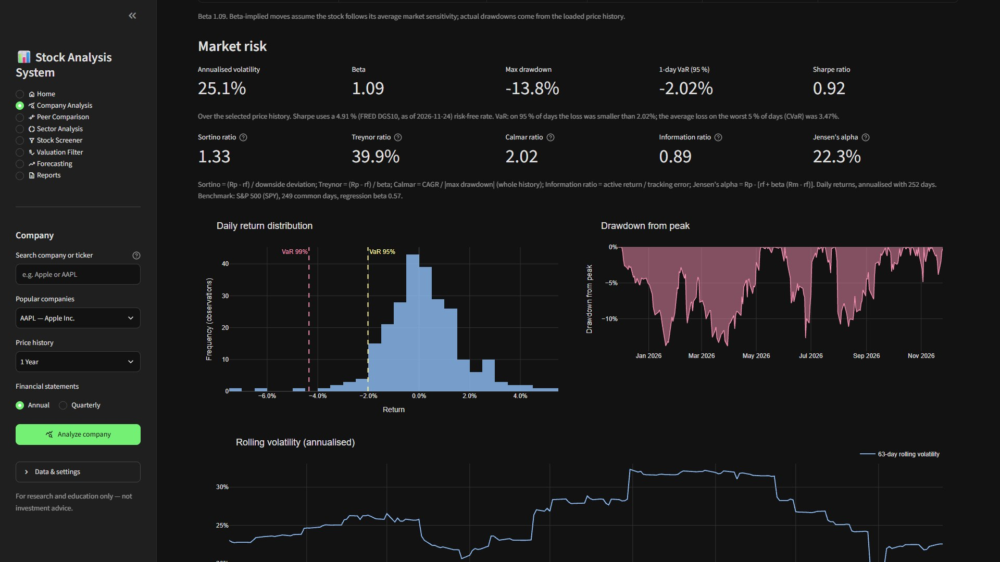 | 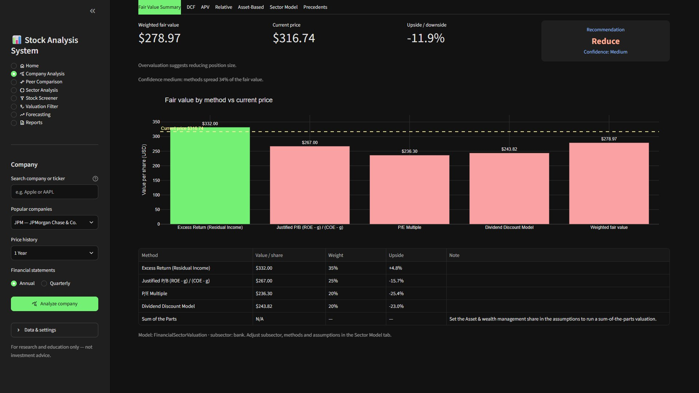 |
| **Market risk (AAPL).** Volatility, VaR, drawdown, Sharpe, Sortino, Treynor, Calmar and Jensen's alpha. | **Bank valuation (JPM).** Residual income, justified P/B and DDM instead of a DCF: $278.97, Reduce. |
| 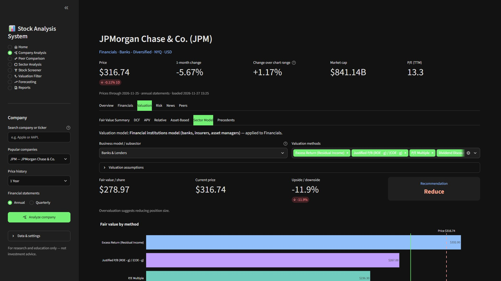 | 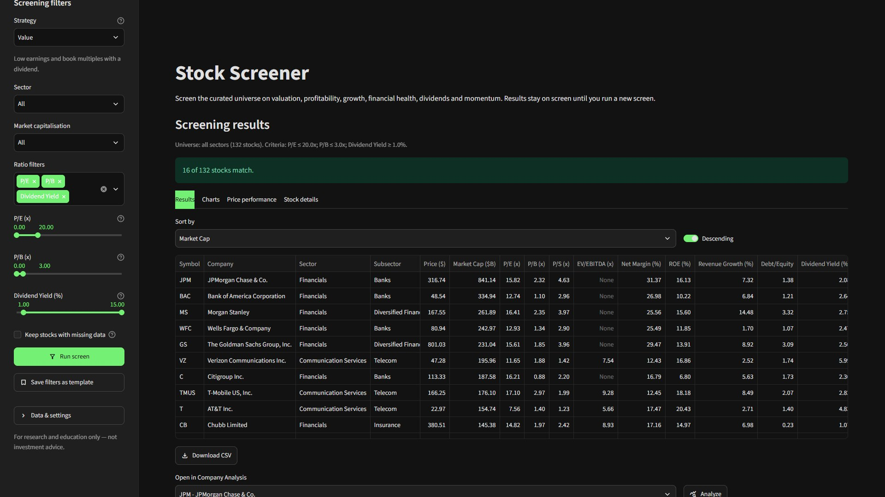 |
| **Sector model controls (JPM).** Pick the subsector, methods and assumptions; the value updates in place. | **Stock screener.** Value preset (P/E, P/B, dividend yield): 16 of 132 large caps match. |
| 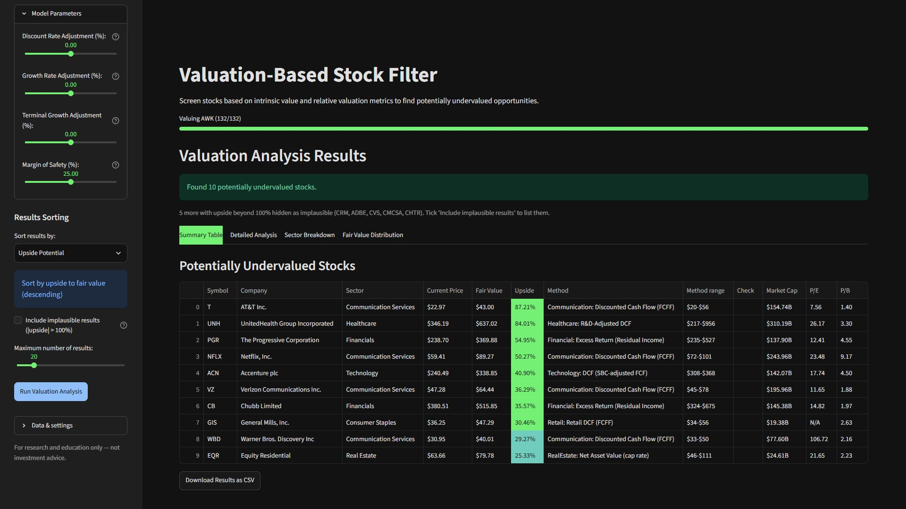 | 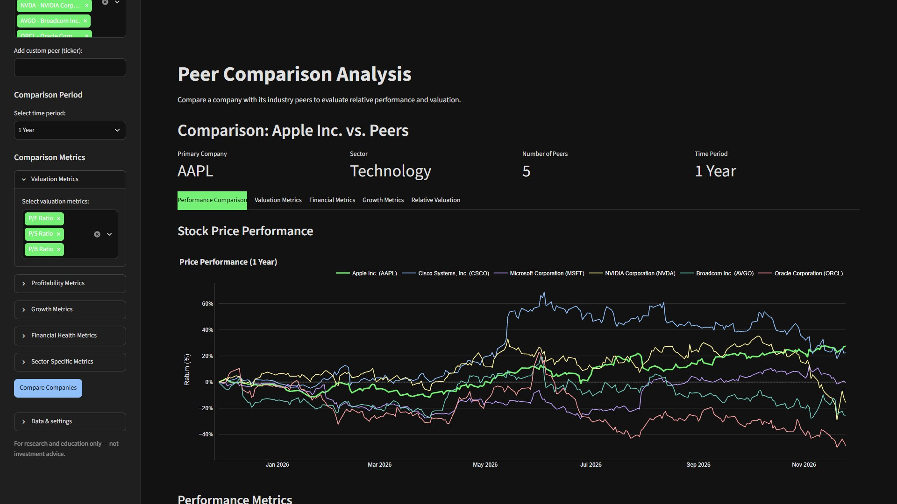 |
| **Valuation filter.** Whole universe ranked by model upside, implausible results hidden. | **Peer comparison.** AAPL against five technology peers on 1-year price performance and metrics. |
| 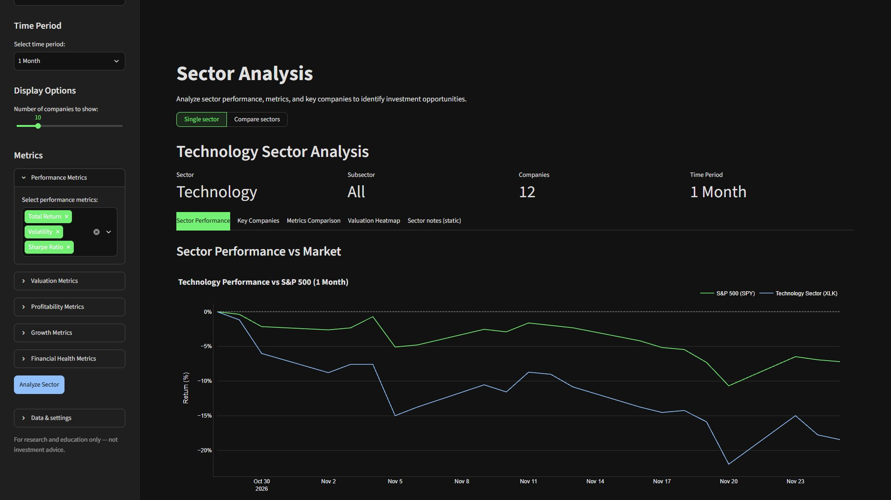 | 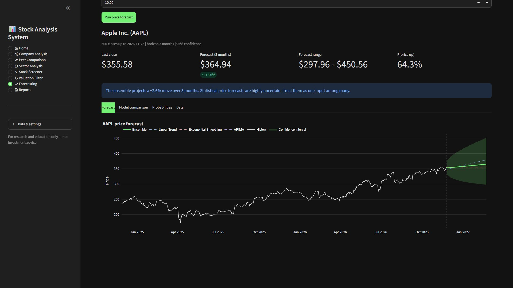 |
| **Sector analysis.** Technology ETF (XLK) against the S&P 500 with its key companies. | **Price forecast (AAPL).** ARIMA, exponential smoothing and trend ensemble with a 95 % band and P(price up). |

## Quickstart
Requirements: Python 3.11+ (CI runs 3.11, 3.12 and 3.13).

```bash
git clone https://github.com/imnotkeril/Stock_Valuation.git
cd Stock_Valuation
python -m venv .venv && source .venv/bin/activate      # Windows: .venv\Scripts\activate
pip install -r StockAnalysisSystem/requirements.txt
python StockAnalysisSystem/run.py
```

Open http://localhost:8501 (health check: `/_stcore/health`). Pick a quick-start ticker on Home, or choose **Company Analysis** in the sidebar, type a name or ticker and press Enter.

### Docker
```bash
docker build -f StockAnalysisSystem/Dockerfile -t stock-analysis .
docker run -p 8501:8501 --env-file .env stock-analysis
```

## Configuration
Copy `.env.example` to `.env` (repository root or `StockAnalysisSystem/`). Every setting is optional: Yahoo Finance works without a key, and a feature that needs a missing key explains what to add.

| Variable | Purpose |
|---|---|
| `ALPHA_VANTAGE_API_KEY` | Fallback for prices, company overview and symbol search; news sentiment with a premium key |
| `FINNHUB_API_KEY` | Company news and peers (News tab); insider transactions (Overview tab) |
| `FINANCIAL_MODELING_PREP_API_KEY` | Recent M&A announcements on Valuation > Precedents |
| `SEC_EDGAR_USER_AGENT` | Your name and e-mail (SEC requirement) for filings and 10-year XBRL history |
| `STOCK_ANALYSIS_OFFLINE` | `1` = never call external APIs, serve cached data only |
| `STOCK_ANALYSIS_RISK_FREE_RATE` | Fix the risk-free rate in percent instead of the live FRED 10-year yield |

Use **Data & settings > Clear cached data** in the sidebar to force a refresh. Optional package: `prophet` (Prophet forecasts).

## Testing
| Task | Command |
|---|---|
| Install dev tools | `pip install -r StockAnalysisSystem/requirements-dev.txt` |
| Tests (offline, 543) | `python -m pytest -o addopts="" -p no:warnings` |
| Lint | `python -m ruff check StockAnalysisSystem` |
| Docs check | `python StockAnalysisSystem/tools/docs_check.py` |

The suite never touches the network: it uses statements and prices recorded from Yahoo Finance for Apple and Microsoft, synthetic companies for every sector, golden hand-computed values for DCF, WACC, APV, residual income and DDM, and drives every Streamlit page with `streamlit.testing.v1.AppTest`. CI runs ruff and pytest on Python 3.11-3.13 for every push and pull request. Live checks against real data are recorded in [docs/QA.md](docs/QA.md).

## Using the models from Python
```python
from StockAnalysisSystem.src.utils.data_loader import DataLoader
from StockAnalysisSystem.src.valuation.sector_factor import ValuationFactory

factory = ValuationFactory(DataLoader())
result = factory.get_company_valuation("AAPL")
print(result["value_per_share"], result["potential_upside"], result["recommendation"]["label"])
for key, method in result["valuation_methods"].items():
    print(method["method"], method["value_per_share"])
```

## Project structure
```
StockAnalysisSystem/
├── run.py                         # Launcher (python StockAnalysisSystem/run.py)
├── Dockerfile
├── requirements.txt / requirements-dev.txt
├── tools/
│   ├── docs_check.py              # Checks README / USER_GUIDE / METHODOLOGY links, screenshots and disclaimer
│   └── live_valuation_check.py    # Live fair values for given tickers (network)
├── src/
│   ├── main.py                    # App shell: navigation, company selection, data loading
│   ├── navigation.py              # Page names and cross-page navigation helpers
│   ├── config.py                  # Settings, sector names, DCF parameters, risk-free fallback
│   ├── utils/
│   │   ├── data_loader.py         # yfinance / Alpha Vantage / FRED access with caching
│   │   ├── rates.py               # Risk-free rate (override -> FRED DGS10 -> fallback)
│   │   ├── financial_data.py      # Robust statement line-item lookup, canonical data bundle
│   │   ├── insider.py             # Finnhub insider transactions (optional key)
│   │   ├── news_sentiment.py      # Finnhub and Alpha Vantage news
│   │   ├── sec_edgar.py           # SEC EDGAR filings and XBRL history
│   │   ├── visualization.py       # Shared Plotly charts
│   │   └── export.py              # Excel / CSV / JSON / HTML / PDF exports
│   ├── models/                    # Ratio analysis, statements, bankruptcy models, performance ratios,
│   │                              # A1-A4/P1-P4 liquidity, precedent transactions, stress tests, forecasting
│   ├── valuation/
│   │   ├── capital.py             # One cost of capital for every model (ADR-007)
│   │   ├── base_valuation.py      # Unified valuation contract, recommendation and confidence
│   │   ├── dcf_models.py          # Multi-stage, forecast-driven, Monte Carlo and scenario DCF
│   │   ├── apv.py                 # Adjusted present value
│   │   ├── liquidation.py         # Orderly and forced liquidation value
│   │   ├── sector_factor.py       # ValuationFactory: sector -> model
│   │   └── sector_specific/       # One model per sector
│   ├── industry/                  # Company universe, sector benchmarks, live sector medians
│   └── pages/                     # Streamlit pages (company analysis, comparison, screening, ...)
└── tests/                         # Offline test suite, including golden hand-computed values
```

## Data sources and limitations
- Market data and fundamentals come from Yahoo Finance via `yfinance` (unofficial API: availability and field coverage vary by company).
- The risk-free rate is FRED `DGS10`; SEC filings come from SEC EDGAR; insider and news data come from Finnhub and Alpha Vantage when their keys are set.
- Statement history is limited to what the provider returns (typically 4-5 annual periods; SEC EDGAR adds up to 10 years).
- Peer and screening universes are a curated list of about 130 large-cap US companies (`src/industry/universe.py`).
- Valuation outputs depend heavily on assumptions and on known simplifications; the open items are listed in [docs/METHODOLOGY.md §10](docs/METHODOLOGY.md#10-known-biases-and-open-items).

## Security
The app is local and single-user: it binds to `localhost` (Docker binds `0.0.0.0` inside the container), has no accounts and never places orders. API keys are read from `.env` only and never committed. See [SECURITY.md](SECURITY.md) for reporting.

## Documentation
[User guide](docs/USER_GUIDE.md) · [Methodology](docs/METHODOLOGY.md) · [Specification](docs/SPEC.md) · [Architecture](docs/ARCHITECTURE.md) · [Decisions](docs/adr/) · [QA report](docs/QA.md) · [Changelog](CHANGELOG.md)

## Contributing
Issues and pull requests are welcome; see [CONTRIBUTING.md](CONTRIBUTING.md).

## License
MIT. See [LICENSE](LICENSE).
