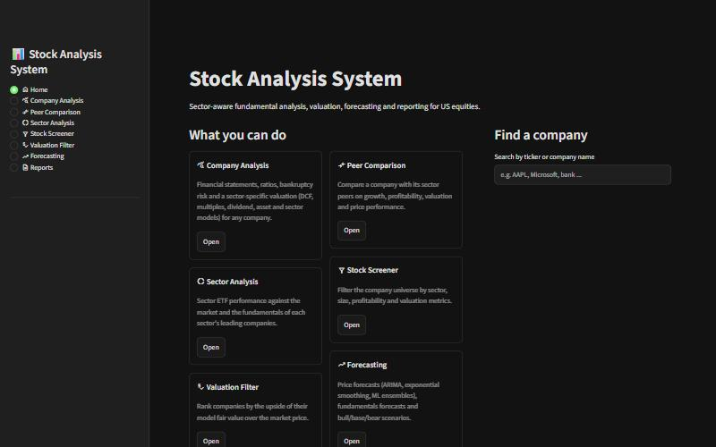
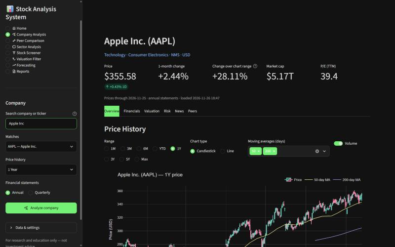
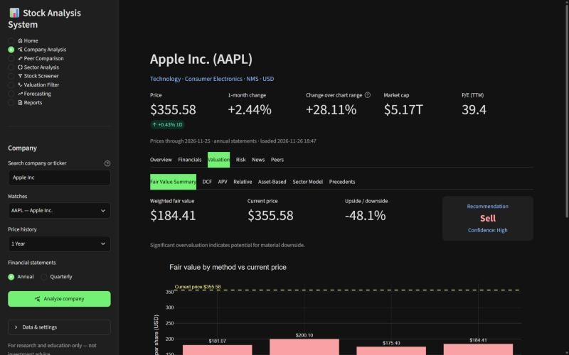
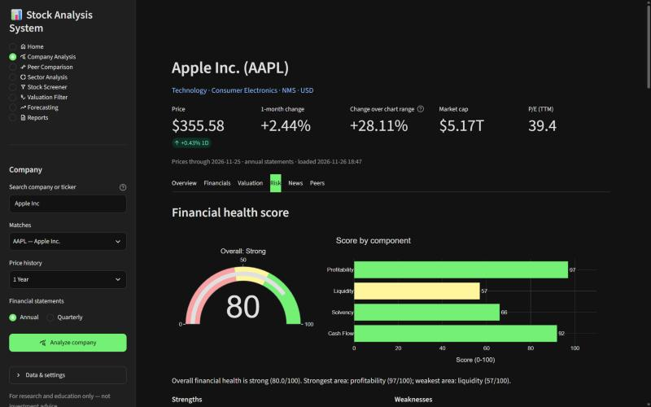
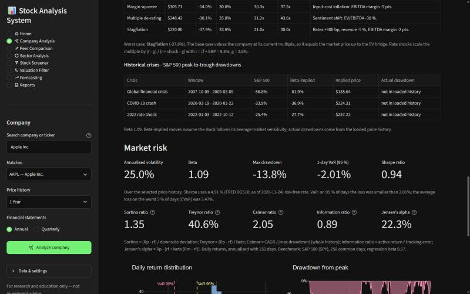

# Stock Analysis System

A Streamlit application for fundamental analysis and **sector-specific valuation** of US large-cap companies: financial statements, ratio benchmarking, weighted fair value from several methods, distress and liquidity models, risk and performance ratios, peer and sector comparison, screening, forecasting and exportable reports.

> **For research and education only.** Everything the application shows is a model estimate and is not investment advice. No output is a recommendation to buy or sell a security.

**Docs:** [User guide](docs/USER_GUIDE.md) · [Methodology: how every number is made](docs/METHODOLOGY.md) · [Changelog](CHANGELOG.md) · [Specification](docs/SPEC.md) · [Architecture](docs/ARCHITECTURE.md)



## Features

| Area | What you get |
|---|---|
| **Company analysis** | Price chart with moving averages and volume, key statistics, business profile, performance vs. the sector ETF, technical indicators |
| **Overview** | SEC EDGAR filings and 10-year XBRL history (needs `SEC_EDGAR_USER_AGENT`); insider transactions with a 90-day open-market buy/sell summary (needs `FINNHUB_API_KEY`) |
| **Financials** | Income statement, balance sheet, cash flow, margins, growth/CAGR, common-size statements, financial health score, ratios with sector benchmarks, A1-A4 / P1-P4 liquidity grouping |
| **Valuation** | Weighted fair value with a recommendation and confidence level; DCF tab on unlevered FCF with growth fade and SBC; APV; relative multiples on live sector medians; asset-based value and liquidation value; sector model; precedent transactions (cross-check) |
| **Sector models** | A dedicated model for every GICS sector, with subsector methods and adjustable assumptions (see below) |
| **Risk** | Altman Z (variant chosen by sector), Springate, Zmijewski (probit), liquidity and solvency, scenario and revenue stress tests, volatility, VaR / CVaR, max drawdown, Sharpe, Sortino, Treynor, Calmar, information ratio and Jensen's alpha vs. the S&P 500 |
| **News** | Headlines with sentiment, daily sentiment chart, peers (Finnhub; Alpha Vantage with a premium key) |
| **Comparison** | Peer comparison (performance, ratios, valuation), sector analysis vs. the market, side-by-side comparison of several sectors |
| **Screening** | Ratio-based stock screener with presets and saved templates, and a valuation filter for under- and over-valued stocks |
| **Forecasting** | ARIMA, exponential smoothing, linear, machine learning, neural network (MLP) and ensemble price forecasts with confidence bands and backtests; fundamentals forecasts; FRED macro indicators |
| **Reports** | Company, valuation, comparison and sector reports as Excel, CSV, JSON, **HTML** or PDF downloads (Excel and PDF need `openpyxl` and `fpdf2`, both in `requirements.txt`) |

Every number has a documented method, with its defaults, bounds and known biases, in [docs/METHODOLOGY.md](docs/METHODOLOGY.md). The risk-free rate is the FRED 10-year Treasury yield (`DGS10`), and the equity risk premium is a constant 4.4 %.

### Screenshots

| | |
|---|---|
|  |  |
| Company overview (AAPL): price, statistics, chart | Valuation summary (AAPL): weighted fair value by method, recommendation and confidence |
|  |  |
| Risk tab: financial health score (AAPL) | Risk tab: stress scenarios, market risk and the risk-adjusted ratios (AAPL) |

### Sector-specific valuation

`ValuationFactory` maps each company to a specialised model. Every model declares its subsectors, methods and user-adjustable assumptions, and the UI builds its controls from that declaration.

| Sector (GICS) | Model | Examples of methods |
|---|---|---|
| Technology | `TechnologySectorValuation` | SBC-adjusted DCF, revenue DCF, EV/Revenue & EV/EBITDA multiples, Rule-of-40 adjusted multiples |
| Financials | `FinancialSectorValuation` | Residual income / excess return, justified P/B, P/E, dividend discount (common equity; no DCF) |
| Energy, Utilities | `EnergySectorValuation` | DCF, reserve-based NAV, sum-of-the-parts, regulated asset base, contracted cash flows |
| Consumer Discretionary, Consumer Staples | `RetailSectorValuation` | Retail DCF, multiples, store-based / unit economics, sum-of-the-parts |
| Industrials, Materials | `ManufacturingSectorValuation` | Cycle-normalised DCF, replacement value, multiples, earnings power value |
| Real Estate | `RealEstateValuation` | NAV (cap rate on NOI), P/FFO and P/AFFO (Nareit FFO), real estate DCF |
| Healthcare | `HealthcareValuation` | R&D-capitalised DCF, healthcare multiples, pipeline rNPV |
| Communication Services | `CommunicationValuation` | DCF, multiples, subscriber/user-based valuation on cash margin, content library value |

All models return the same result schema (`BaseValuation.build_valuation_result`): per-method values, a weighted fair value, upside versus the current price, a recommendation and a confidence level. Method weights and subsector overrides are listed in [docs/METHODOLOGY.md §6](docs/METHODOLOGY.md#6-sector-models-and-blending-weights).

## Quick start

Requirements: Python 3.11+.

```bash
git clone https://github.com/imnotkeril/Stock_Valuation.git
cd Stock_Valuation
python -m venv .venv && source .venv/bin/activate
pip install -r StockAnalysisSystem/requirements.txt
python StockAnalysisSystem/run.py
```

On Windows use `.venv\Scripts\activate` and `python StockAnalysisSystem\run.py`.

The app opens at http://localhost:8501 (health check: `/_stcore/health`). Choose **Company Analysis** in the sidebar, type a company name or ticker and press Enter, or pick a result and click **Analyze company**.

### Docker

```bash
docker build -f StockAnalysisSystem/Dockerfile -t stock-analysis .
docker run -p 8501:8501 --env-file .env stock-analysis
```

## Configuration

Copy `.env.example` to `.env` (repository root or `StockAnalysisSystem/`). Every setting is optional: Yahoo Finance works without a key.

| Variable | Purpose |
|---|---|
| `ALPHA_VANTAGE_API_KEY` | Fallback provider for prices, company overview and symbol search; per-ticker news sentiment with a premium key |
| `FINNHUB_API_KEY` | Company news and peers (News tab); insider transactions on the Overview tab |
| `FINANCIAL_MODELING_PREP_API_KEY` | Recent M&A announcements on Valuation > Precedents |
| `SEC_EDGAR_USER_AGENT` | Your name and e-mail (required by SEC) to load filings and 10-year history from SEC EDGAR on the Overview tab |
| `STOCK_ANALYSIS_OFFLINE` | `1` = never call external APIs, serve cached data only |

Without a key, the feature that needs it explains what to add and does not raise an error.

Downloaded data is cached in `StockAnalysisSystem/src/data/cache` (git-ignored). When a provider is unavailable, the last cached copy is served. Use **Data & settings → Clear cached data** in the sidebar to force a refresh.

FRED macro indicators and the risk-free rate need no key. Optional package: `prophet` (Prophet forecasts).

## Run, build and test

| Task | Command |
|---|---|
| Run the app | `python StockAnalysisSystem/run.py` (Windows venv: `.venv\Scripts\python.exe StockAnalysisSystem\run.py`) |
| Test (offline) | `pip install -r StockAnalysisSystem/requirements-dev.txt` then `python -m pytest -o addopts="" -p no:warnings` |
| Lint | `python -m ruff check StockAnalysisSystem` |
| Docs check | `python StockAnalysisSystem/tools/docs_check.py` |
| Docker build | `docker build -f StockAnalysisSystem/Dockerfile -t stock-analysis .` |

The test suite never touches the network. It uses statements and prices recorded from Yahoo Finance for Apple and Microsoft, and internally consistent synthetic companies for every sector. The Streamlit pages are exercised end to end with `streamlit.testing.v1.AppTest`. Live checks against real data are recorded in [docs/QA.md](docs/QA.md).

## Using the valuation models from Python

```python
from StockAnalysisSystem.src.utils.data_loader import DataLoader
from StockAnalysisSystem.src.valuation.sector_factor import ValuationFactory

factory = ValuationFactory(DataLoader())
result = factory.get_company_valuation("AAPL")
print(result["value_per_share"], result["potential_upside"], result["recommendation"]["label"])
for key, method in result["valuation_methods"].items():
    print(method["method"], method["value_per_share"])
```

## Project structure

```
StockAnalysisSystem/
├── run.py                         # Launcher (python StockAnalysisSystem/run.py)
├── Dockerfile
├── requirements.txt / requirements-dev.txt
├── tools/
│   ├── docs_check.py              # Checks README / USER_GUIDE / METHODOLOGY links, screenshots and disclaimer
│   └── live_valuation_check.py    # Live fair values for given tickers (network)
├── src/
│   ├── main.py                    # App shell: navigation, company selection, data loading
│   ├── navigation.py              # Page names and cross-page navigation helpers
│   ├── config.py                  # Settings, sector names, DCF parameters, risk-free fallback
│   ├── utils/
│   │   ├── data_loader.py         # yfinance / Alpha Vantage / FRED access with caching
│   │   ├── rates.py               # Risk-free rate (override -> FRED DGS10 -> fallback)
│   │   ├── financial_data.py      # Robust statement line-item lookup, canonical data bundle
│   │   ├── insider.py             # Finnhub insider transactions (optional key)
│   │   ├── news_sentiment.py      # Finnhub and Alpha Vantage news
│   │   ├── sec_edgar.py           # SEC EDGAR filings and XBRL history
│   │   ├── visualization.py       # Shared Plotly charts
│   │   └── export.py              # Excel / CSV / JSON / HTML / PDF exports
│   ├── models/                    # Ratio analysis, statements, bankruptcy models, performance ratios,
│   │                              # A1-A4/P1-P4 liquidity, precedent transactions, stress tests, forecasting
│   ├── valuation/
│   │   ├── capital.py             # One cost of capital for every model (ADR-007)
│   │   ├── base_valuation.py      # Unified valuation contract, recommendation and confidence
│   │   ├── dcf_models.py          # Multi-stage, forecast-driven, Monte Carlo and scenario DCF
│   │   ├── apv.py                 # Adjusted present value
│   │   ├── liquidation.py         # Orderly and forced liquidation value
│   │   ├── sector_factor.py       # ValuationFactory: sector -> model
│   │   └── sector_specific/       # One model per sector
│   ├── industry/                  # Company universe, sector benchmarks, live sector medians
│   └── pages/                     # Streamlit pages (company analysis, comparison, screening, ...)
└── tests/                         # Offline test suite, including golden hand-computed values
```

Decisions are recorded in [`docs/adr/`](docs/adr/); the product review is in [`docs/review/`](docs/review/).

## Data sources and limitations

- Market data and fundamentals come from Yahoo Finance via `yfinance` (unofficial API: availability and field coverage vary by company).
- The risk-free rate is FRED `DGS10`; SEC filings come from SEC EDGAR; insider and news data come from Finnhub and Alpha Vantage when their keys are set.
- Statement history is limited to what the provider returns (typically 4-5 annual periods; SEC EDGAR adds up to 10 years).
- Peer and screening universes are a curated list of about 130 large-cap US companies (`src/industry/universe.py`).
- Valuation outputs depend heavily on assumptions and on known simplifications; the open items are listed in [docs/METHODOLOGY.md §10](docs/METHODOLOGY.md#10-known-biases-and-open-items).

## Disclaimer

For research and education only. Nothing in this application, its reports or its exports is investment advice, a recommendation to buy or sell any security, or a forecast of any price. Check every number against the company's filings before you rely on it.

## License

MIT - see [LICENSE](LICENSE).
