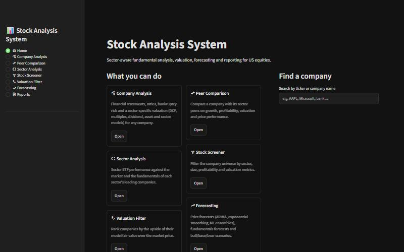

# User guide

Stock Analysis System is a local web app for analysing and valuing US large-cap companies.
It is for research and education only. Its output is not investment advice.

For how each number is computed (inputs, defaults, bounds, known biases) read
[METHODOLOGY.md](METHODOLOGY.md). This guide covers what you do in the app.



## 1. Start

```
python -m venv .venv
.venv\Scripts\activate            (macOS / Linux: source .venv/bin/activate)
pip install -r StockAnalysisSystem/requirements.txt
python StockAnalysisSystem/run.py
```

Open http://localhost:8501. The app only listens on this computer. Docker:
`docker build -f StockAnalysisSystem/Dockerfile -t stock-analysis .` then
`docker run -p 8501:8501 --env-file .env stock-analysis`.

## 2. Optional keys (`.env`)

Copy `.env.example` to `.env`. Everything works with Yahoo Finance and FRED alone. Each key unlocks
one extra feature; a feature without its key tells you what to add and does not raise an error.

| Setting | Unlocks | Where to get it |
|---|---|---|
| `SEC_EDGAR_USER_AGENT` | Overview > SEC filings and 10-year history | Your own `Name email@domain` (SEC requires a contact) |
| `FINNHUB_API_KEY` | News tab (headlines, sentiment, peers) and **Overview > Insider transactions** | finnhub.io, free |
| `ALPHA_VANTAGE_API_KEY` | News tab per-ticker sentiment (premium key); price fallback | alphavantage.co, free |
| `FINANCIAL_MODELING_PREP_API_KEY` | Valuation > Precedents: recent M&A feed | financialmodelingprep.com |
| `STOCK_ANALYSIS_OFFLINE=1` | Never call the internet; use cached data only | - |

Data is cached in `StockAnalysisSystem/src/data/cache`. **Data & settings > Clear cached data** in the
sidebar forces a refresh. Your own data (screener templates, precedent deals) is in
`StockAnalysisSystem/src/data/user`.

## 3. Find a company

1. In the sidebar, type a company name or ticker in **Search company or ticker**.
2. The **Matches** list shows the candidates. If there is exactly one US match, press **Enter** and the
   company is analysed at once (no need to click **Analyze company**). Foreign listings (for example
   `AAPL.SAO`) are not counted as matches.
3. With several matches, choose one in the list and click **Analyze company**.
4. Pick the **Price history** range and **Annual** or **Quarterly** statements.

The header shows the price, the change over the chart range (the date range is in the tooltip), market cap and
P/E. Prices are as of the date shown under the header.

## 4. Pages

### Home
Feature overview, company search, quick-start tickers (one per sector) and a sector ETF snapshot.

### Company Analysis
Each company has tabs. Each tab loads when you open it.

| Tab | What you see |
|---|---|
| Overview | Price chart with moving averages, key statistics, business profile, financial snapshot, key ratios vs. sector, performance vs. sector ETF, technical indicators, **SEC filings and long-term history** (button), **Insider transactions** (with `FINNHUB_API_KEY`) |
| Financials | Income statement, balance sheet, cash flow, margins, growth, common-size statements, health score, ratios vs. sector benchmarks, and the **A1-A4 / P1-P4 liquidity grouping** |
| Valuation | **Fair Value Summary** (weighted), **DCF**, **APV**, **Relative** multiples, **Asset-Based** (with **Liquidation value**), **Sector Model**, **Precedents** |
| Risk | Financial health score, Altman Z / Springate / Zmijewski, liquidity and solvency vs. sector, revenue stress test, **scenario analysis** (macro shocks, 2008 / 2020 / 2022), **market risk** with the risk-adjusted ratios |
| News | Headlines with sentiment, daily sentiment, peers (needs Finnhub or Alpha Vantage key) |
| Peers | Comparison with sector peers |

#### Reading the Fair Value Summary
- **Fair value** is the weighted average of the methods that ran, for the default method weights of the
  company's sector. Methods that cannot be computed are left out and listed.
- **Upside / downside** is the fair value against the current price.
- **Recommendation** is a label from the upside: Strong Buy (at least +25 %), Buy (at least +10 %), Hold
  (at least -10 %), Reduce (at least -25 %), Sell (below -25 %).
- **Confidence** (High, Medium, Low) counts the reasons the value may be less reliable: methods disagreeing, a
  terminal value above 80 % of a DCF, few usable methods, short statement history, or an implausible upside.
  With Low confidence the label is softened to "Below model value" or "Above model value", and the reasons are
  listed. An upside above +-100 % is marked as implausible: check the inputs before using it.

#### DCF tab
- The cash flow is **unlevered** (interest added back after tax). This is a change from earlier versions, which
  counted interest twice.
- Growth **fades** linearly to the terminal growth rate by default; switch the fade off to keep the forecast
  growth flat.
- **SBC** (stock-based compensation) is deducted by default when the company reports it. Stock-based pay is a real
  cost; turn the deduction off only to compare with a reported-FCF view.
- Terminal growth above the risk-free rate is flagged; stable growth cannot exceed the economy's nominal growth.
- The WACC on the slider starts from the shared cost of capital (same rate as the Sector Model and APV). Its
  components (risk-free rate with date, ERP, beta, cost of debt, tax) are in the assumptions.

#### APV, Relative, Asset-Based
- **APV** values the company without debt and adds the tax shield of its debt. It does not apply to banks and
  insurers, and the tab says so.
- **Relative** multiples use live sector medians from the companies already in your cache (at least five per
  multiple, dated, at most 30 days old). Without enough cached data it uses static sector medians and names
  them. P/B is dropped for sectors where book value says little; banks are not valued on EV/EBITDA or P/S.
  The "Used" column shows what was applied.
- **Asset-Based**: the net asset value and the **Liquidation value** section. It shows orderly and forced
  liquidation value per share from asset-class recovery rates (cash 100 %, receivables, inventory, PP&E, other
  assets, intangibles 0) minus all liabilities. Edit the recovery rates in the table to test your own view. It
  is a floor for distressed companies and is **not** part of the weighted fair value. Not computed for banks and
  insurers.

#### Sector Model
Sector-specific methods with adjustable assumptions. Enable the overrides to change assumptions. **Sum of the
Parts**: set the second segment's share (from the segment note of the annual report) and both multiples. With
share 0 the method is not run and does not affect the fair value.

#### Precedents
- Add deals to the table (date, acquirer, target, sector, EV/Revenue and/or EV/EBITDA, source) and click **Save
  deals**, or import a CSV with the same columns.
- **Load an illustrative sample** adds five fictional deals so you can see the layout. The sample is labelled,
  and it is not saved until you save it. A warning appears whenever sample rows feed the numbers.
- Precedents are a **cross-check only and not part of the weighted fair value.** Deal multiples include a control
  premium, so they are usually above trading multiples.

#### Risk tab: ratios
The market risk block shows the classic measures and the risk-adjusted ratios with one-line definitions under them:

- **Sharpe**: return above the risk-free rate per unit of volatility.
- **Sortino**: like Sharpe, but only downside volatility counts.
- **Treynor**: return above the risk-free rate per unit of market beta (N/A when beta is zero or negative).
- **Calmar**: annual return divided by the largest drawdown (trailing 36 months where the history allows).
- **Information ratio**: return above the S&P 500 per unit of tracking error.
- **Jensen's alpha**: return above what the stock's beta predicts from the S&P 500.

The benchmark is the S&P 500 (SPY). When it is unavailable, the benchmark-based ratios show N/A. Each ratio is
N/A when its input is missing. The header caption gives the risk-free rate and its source and date.

#### Overview: insider transactions
With `FINNHUB_API_KEY`, the Overview tab lists recent Form 4 transactions (date, name, type, shares, price,
value) and a **90-day summary** of open-market buys and sells (purchases and sales only; grants, option exercises,
tax withholding and gifts are listed but not counted). Without the key the section says how to enable it.

### Peer Comparison
Compare a company with its sector peers on growth, profitability, valuation and price performance. The page
opens empty with a hint and a **run** button in the main area; the results stay when you change the view.

### Sector Analysis
- **Single sector**: sector ETF vs. market, leading companies, metric comparison, valuation heatmap, outlook.
  Opens with a **run** button in the main area.
- **Sector notes (static)**: a tab with reference notes written into the app (value drivers, risks, typical
  ratios). These are text, not live data.
- **Compare sectors**: pick 2-6 sectors - growth of 100 vs. SPY, return / volatility / drawdown / Sharpe, median
  fundamentals of each sector's largest companies, leading sector per metric.

### Stock Screener
Choose a strategy preset or build filters (sector, market cap, ratio ranges) and click **Run screen**.
**Save filters as template** stores the current filters under a name; saved templates appear in the Strategy list
with "(saved)" and can be deleted there. The first run with an empty cache downloads the universe; fetches run in
parallel under a rate limit. The later runs use the cache and are much faster.

### Valuation Filter
Ranks companies by the upside of their model fair value over the market price. Results with an upside beyond
+-100 % are hidden unless you tick **Include implausible results**, and each row shows the method that produced
its value. Adjust multiple discounts and DCF assumptions.

### Forecasting
Price forecasts (ARIMA, exponential smoothing, linear trend, random walk, machine learning, **neural network
(MLP)**, ensembles) with confidence bands and hold-out backtests; fundamentals forecasts; macro indicators from
FRED (free, no key); Prophet (needs `prophet`).

### Reports
Company, valuation, comparison and sector reports as **Excel, CSV, JSON, HTML** or **PDF** downloads. Excel and PDF
are offered when their packages are installed (`openpyxl`, `fpdf2`). The HTML file is self-contained and opens in
any browser, with the charts as images. Every report carries the research-only disclaimer.

## 5. Settings you can change

- **Risk-free rate**: by default the FRED 10-year Treasury yield (`DGS10`), cached for a day. To use your own rate,
  set the environment variable `STOCK_ANALYSIS_RISK_FREE_RATE` to a value such as `4.5` (percent) or `0.045`
  (fraction). The source and date are shown with every result.
- **Equity risk premium**: fixed at 4.4 % (Damodaran's implied US estimate, rounded). Changing it requires a code
  change; see METHODOLOGY.md, section 3.
- **Method weights and assumptions**: each tab shows them. Weights are normalised over the methods that ran.

## 6. Limits
- Yahoo Finance is unofficial: coverage varies by company and statements cover 4-5 years
  (SEC EDGAR adds up to 10).
- The peer and screening universe is about 130 large US companies.
- Every valuation depends on its assumptions. Check the per-method details, then adjust them.
- Known biases and open items are listed in [METHODOLOGY.md section 10](METHODOLOGY.md#10-known-biases-and-open-items).
- Sentiment scores are context, not trading signals.

## 7. Disclaimer

For research and education only. Nothing in this app, its reports or its exports is investment advice, a
recommendation to buy or sell a security, or a forecast of a share price.
